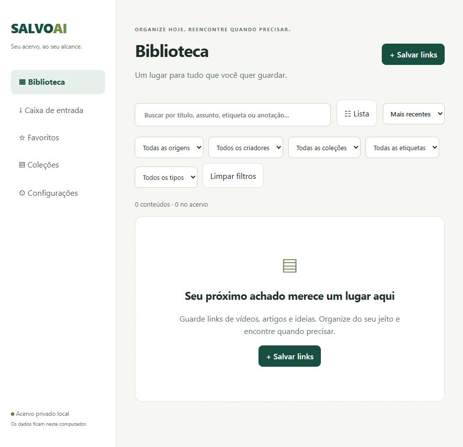
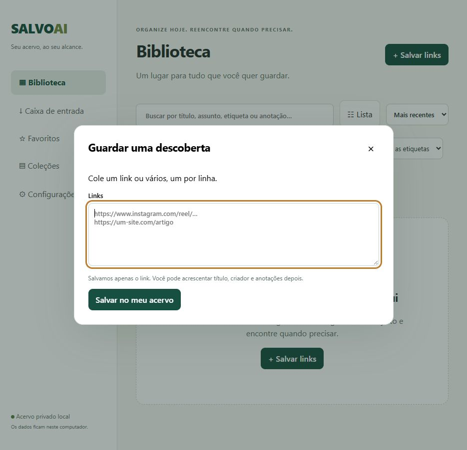

# Curadoria UI · SALVOAI · 12/10/2026

Direção recomendada: biblioteca editorial premium e minimalista. O acervo e a busca devem dominar a tela. Sofisticação virá de hierarquia, densidade equilibrada, alinhamento e estados consistentes. Stack atual preservada: HTML/CSS/JS + Node/SQLite; nenhuma mudança de código ou instalação autorizada por esta curadoria.

Catálogo consultado: D:/ESTUDOS/Projetos Vibe Coding/AGENT_REPERTORIO/skills/repertorio-ui/references/catalogo.json, catálogo central indicado pela skill. Referências oficiais verificadas nesta sessão; vibes são avaliação de curadoria, não declaração do fornecedor.

## Evidência atual

1. Biblioteca vazia — funcionalmente clara, visualmente melhorável. Busca visível, ação principal identificável e navegação compreensível. Os cinco selects e Limpar filtros ocupam duas linhas nesta largura, antes do conteúdo. Cabeçalho com frase em caixa alta e descrição tem mais comunicação do que uma ferramenta pessoal precisa. Recomendo título, contagem, busca e ação; filtros recolhidos com indicadores dos selecionados. O estado vazio pode ter mensagem mais curta. Os ícones Unicode têm desenho e peso desiguais.

2. Salvar links — fluxo direto e bom foco visível. Campo aceita lote sem exigir troca de modo. Recomendo manter esse comportamento, uniformizar títulos e espaçamento, testar botão de fechar com alvo de 44 px e manter erros individualizados e anunciados. O foco âmbar atual é perceptível; preservar contraste ao revisar a paleta.

Capturas obtidas do navegador nesta análise e inspecionadas após salvar. Não foram enviados links nem alterado o acervo. Escopo visual capturado: biblioteca vazia e abertura do formulário. Detalhe, biblioteca preenchida e mobile não foram percorridos nesta auditoria. Análise estrutural do detalhe e cartões veio de public/index.html e public/styles.css, não de captura atual dessas telas. Não houve auditoria WCAG completa, contraste quantitativo, leitor de tela ou teste de movimento.

## Direção visual proposta

- Fundo #F7F7F5; superfícies #FFFFFF; texto principal #202624; texto secundário #5F6964; acento verde #174F40. Validar contrastes em cada combinação antes de implementação.
- Texto de corpo 15–16 px; metadados 13–14 px; título de tela 28–32 px. Começar com system-ui/Segoe UI já disponível no Windows. Inter está declarada no CSS, mas não há fonte carregada no HTML; não presumir aparência idêntica em máquinas diferentes.
- Espaçamentos 4, 8, 12, 16, 24 e 32 px. Raios 8 px para controles e 12–16 px para superfícies. Bordas suaves, sombra apenas em overlays e estados que precisam de elevação.
- Uma família de ícones, traço uniforme, 18–20 px; alvos interativos de 44 px como meta de conforto móvel. Não tornar ações essenciais dependentes de hover.
- Movimento breve: 120–180 ms em cor/estado e 180–220 ms em painéis. Respeitar prefers-reduced-motion; evitar animar toda a biblioteca a cada filtro.

## Seleção verificada

| Solução | Aplicação no SALVOAI | Compatibilidade e ressalvas |
| --- | --- | --- |
| [ARC Sheet](https://arcui.dev/docs/components/sheet/) | Filtros em painel inferior no celular; detalhe lateral no desktop | Web Component com JS. Documentação descreve foco, Escape e bloqueio de scroll. Testar foco de retorno e risco de descartar edição não salva. Detalhe completo com muitos campos pode merecer tela própria no celular. |
| [ARC Segmented Control](https://arcui.dev/docs/components/segmented-control/) | Preferência de apresentação Cartões / Lista, com seleção visível | Web Component; opções mutuamente exclusivas, teclado e aria-checked declarados. Usar para preferência de layout, não navegação de páginas. Remover glow para combinar com a direção. |
| [unlumen Sidebar 001](https://ui.unlumen.com/components/sidebar-001) | Referência para navegação agrupada e marcador discreto de página ativa | Catálogo marca Free. Código/exemplo React/TSX, Motion e exemplo Next.js/Lucide; não é instalação direta no app atual. Dependências completas e licença de reutilização não verificadas. Adaptar o padrão com implementação própria; não copiar código sem verificar licença. |
| [Planes Command Palette](https://useplanes.com/components/command-palette) | Referência futura para Ctrl/Cmd+K: encontrar item, abrir coleção ou salvar link | Componente Pro, React; stack do fornecedor inclui Tailwind e Motion. Exige licença comercial e configuração de registry. Não recomendo compra nem migração agora. A paleta pode ser implementada de forma própria depois, complementando a busca sempre visível. |

[ARC Getting Started](https://arcui.dev/docs/getting-started/) informa dependência runtime Lit e imports por componente. A [homepage ARC](https://arcui.dev/) declara MIT e suporte HTML. A [homepage Planes](https://useplanes.com/) identifica stack e acesso comercial. As garantias de acessibilidade dos fornecedores não comprovam acessibilidade do SALVOAI. Não foram habilitados MCPs dessas fontes.

## Como as escolhas convivem

Minha primeira escolha é criar tokens e refinar os componentes nativos existentes. ARC é a opção técnica mais compatível caso componentes mais complexos justifiquem dependências; não instalar a biblioteca inteira por aparência. Uma integração local precisaria empacotar/servir módulos e estilos, ajustar CSP apenas conforme necessário, substituir handlers inline de exemplos por listeners e revisar temas, foco e eventos. CDN remoto contraria a prioridade atual de privacidade e funcionamento independente.

unlumen orienta a composição da navegação; Planes orienta o comportamento da paleta. Ambos ficam como referência, sem mistura de runtimes. Base funcional mantém inputs, dialog e botões coerentes; efeitos pontuais limitam-se ao indicador ativo e abertura de painéis. Não recomendo shaders/3D para esta biblioteca: não resolvem salvar, ler ou reencontrar itens e adicionam manutenção e carga móvel.

## Primeira implementação recomendada

1. Biblioteca: enxugar cabeçalho; agrupar filtros sob botão com contagem; mostrar filtros ativos removíveis; trocar botão alternante por Cartões / Lista com estado explícito; uniformizar ícones.
2. Cartões: dar prioridade a título e origem. Sem imagem real, usar versão textual compacta, eliminando o bloco vazio alto observado no CSS. Limitar etiquetas visíveis com +N, preservando acesso completo no detalhe. Lista com alinhamento estável.
3. Detalhe: coleções e etiquetas selecionáveis em chips com autocomplete, em vez de depender de vírgulas; separar conteúdo, organização e notas; IA ausente em seção secundária recolhida, com estado verdadeiro. Não reduzir descobribilidade de notas ou fonte.
4. Salvar: manter lote no mesmo campo, revisar medidas e resultados, preservar foco e feedback acessível.
5. Mobile: navegação principal compacta com rótulos, busca sempre acessível e filtros em painel. Validar com teclado, zoom, leitor de tela, movimento reduzido e acervo preenchido antes de considerar pronto.

Resultado esperado: mais conteúdo visível, menos competição entre controles, leitura confortável e manutenção simples. Esta é recomendação, não redesign implementado. Arquivos de execução, dados e dependências permaneceram inalterados; foram adicionadas somente estas notas e capturas.
